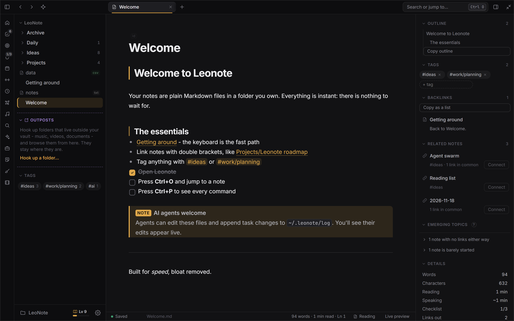
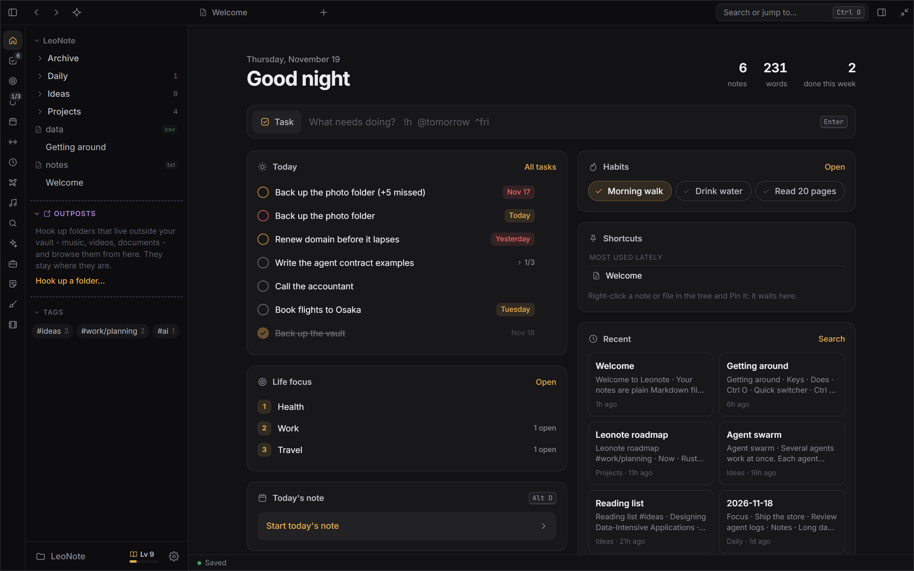
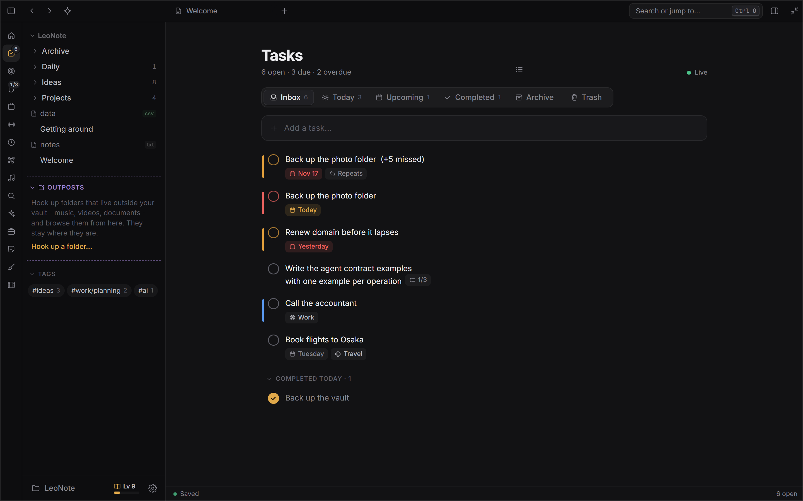
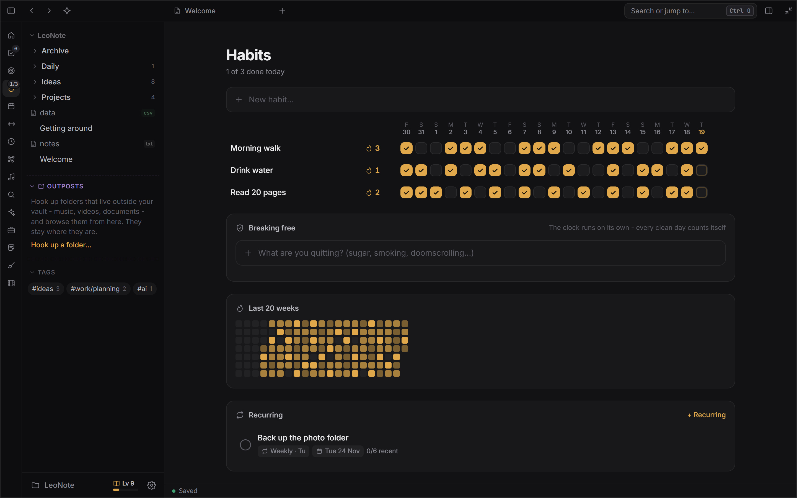
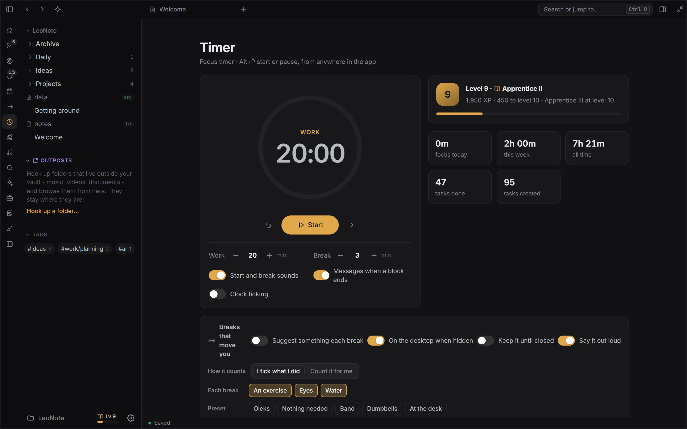
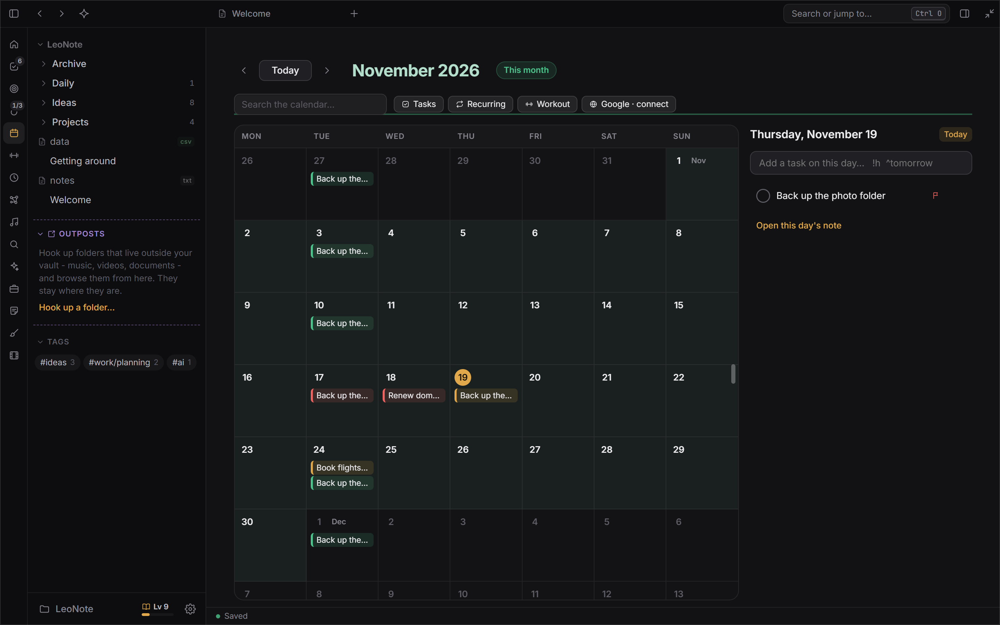
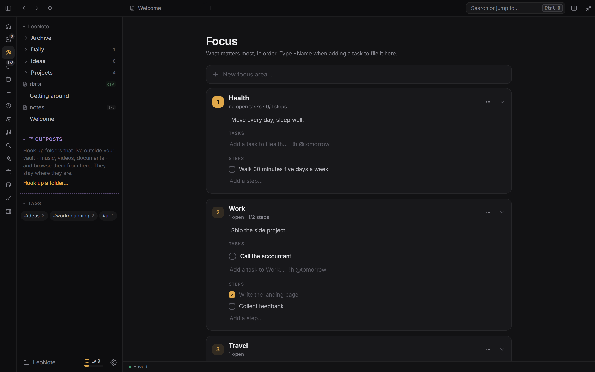
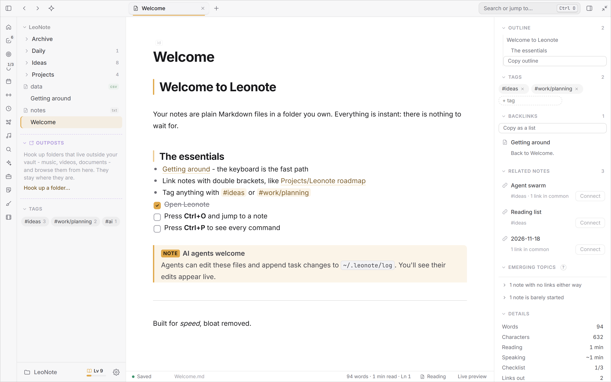

# Leonote 

**Instant, local-first notes and tasks.** Your notes are plain Markdown files on your own computer; tasks, habits,
a focus timer and an AI assistant of your choosing sit right next to them. Rust + Tauri, a CodeMirror 6 live
preview editor, no framework, no loading screens.

## Download

Click one, it downloads the newest version:

| | |
| --- | --- |
| **Windows 10 / 11** | [⬇ **Installer**](https://github.com/Olexify/Leonote/releases/latest/download/Leonote-windows-setup.exe) - open it, Leonote installs and starts. Or [one file, no install](https://github.com/Olexify/Leonote/releases/latest/download/Leonote-windows-portable.exe). |
| **Ubuntu, Debian, Mint** | [⬇ **.deb**](https://github.com/Olexify/Leonote/releases/latest/download/Leonote-linux.deb) - double-click it to install. |
| **Other Linux** | [⬇ **AppImage**](https://github.com/Olexify/Leonote/releases/latest/download/Leonote-linux.AppImage) - right-click › Properties › allow running as a program, then open it. |

Every version, with checksums (`.sha256`): [all releases](https://github.com/Olexify/Leonote/releases). The Windows builds are not code-signed yet, so Windows may show "Windows
protected your PC" the first time: **More info › Run anyway**. The Linux build is new: a few features that lean on
Windows (the phone link, Windows speech, some file previews) are missing or limited there. Problems go to
[Issues](https://github.com/Olexify/Leonote/issues).

**Versions** are named like `Leonote 1.0 · First Roar`: the number says how far along it is (`1.0.1` is a fix for
`1.0`), and each new `1.x` gets its own name.

> **Source-available, all rights reserved.** Leonote is free to use, but it is not open source: the code is here to
> read, not to reuse, build for others or redistribute - see [LICENSE](LICENSE) (section 2A) and
> [THIRD-PARTY-NOTICES.md](THIRD-PARTY-NOTICES.md). Issues are welcome; pull requests are not accepted.

## A quick look

| | |
| :---: | :---: |
|  **Home** - today at a glance |  **Tasks** - due dates, repeats, steps |
|  **Habits** - streaks and a 20-week heatmap |  **Timer** - focus blocks, breaks, XP |
|  **Calendar** - tasks on the month |  **Focus** - what matters most, in order |
|  **Light or dark**, with your accent colour | |

## Your first five minutes

1. **Install and open it.** Leonote makes a `LeoNote` folder in your home folder: that is your vault, plain files.
2. **Write.** `Ctrl N` makes a note. Type Markdown; it renders as you go. `/` opens a menu of blocks (tables, callouts, checkboxes).
3. **Link.** Type `[[` and pick a note. Its backlinks show on the right. `#tags` work anywhere.
4. **Add a task.** `Alt 2` opens Tasks. Type `call bank !h @tomorrow` and press Enter: high priority, due tomorrow.
5. **Find anything.** `Ctrl O` jumps to a note, `Ctrl P` lists every command, `Ctrl Shift F` searches all notes.
6. **Start a focus block.** Open the Timer (clock icon on the left) and press Start. Ticked tasks and focus time earn XP.

## How do I...

<b>...bring my notes from Obsidian or another app?</b>

Open that folder with **Switch vault…** (Settings › Files) or copy the `.md` files into `~/LeoNote`. Links, tags, checkboxes and
front matter are read as they are; nothing is converted or locked in.

<b>...type tasks quickly?</b>

In any "Add a task" box: `!h` / `!m` / `!l` sets the priority, `@tomorrow` or `@fri` the due date, `^fri` the start
date, `@+3` three days from now. `Ctrl Alt N` adds one from anywhere in Windows, even with Leonote hidden. Repeating
ones ("water the plants every Tuesday") come from **+ Recurring** on the Habits page.

<b>...keep my notes on two computers?</b>

Put the vault in any folder sync (OneDrive, Dropbox, Syncthing, a git remote). See [More than one computer](#more-than-one-computer).

<b>...use an AI assistant with my notes?</b>

Open the Assistant (sparkle icon), choose a provider and paste your own key, or pick Ollama / LM Studio to stay on
your computer. Nothing is sent until you press Send, and you see what goes along. Each note or folder can be set to
private, review or open for AI in the tree.

<b>...connect Claude Desktop, Claude Code or Cursor?</b>

Run `leonote-rs.exe --mcp` as an MCP server; the Assistant view shows the exact command to copy. The tools and rules
are in [AGENTS.md](AGENTS.md).

<b>...get the newest version?</b>

Settings › About › Check for updates. The installer and AppImage copies update with one click; the portable `.exe`
is replaced by downloading it again.

<b>...get a deleted note back?</b>

Deleted notes go to `.trash` in the vault and stay there for 30 days by default (Settings › Trash).

## What it does

- **Notes are Markdown files** in a folder you own (`~/LeoNote`). Git them, sync
  them, open them in Obsidian. They are not locked inside the app.
- **Live preview editing** - Markdown renders in place, syntax appears only
  where the caret is. `[[wikilinks]]` with autocomplete, `#tags`, checkboxes,
  callouts, code blocks, tables, `/` slash menu.
- **Backlinks, unlinked mentions, outline, graph.** Renaming a note rewrites
  every link to it.
- **Tasks** with priorities, due and start dates, steps, quick-add syntax
  (`call bank !h @tomorrow ^fri`), fully keyboard driven.
- **Habits** with streaks and a 20-week heatmap. **Daily notes** on `Alt+D`.
- **Recurring tasks and reminders** ("water the plants every Tuesday"),
  with catch-up, snooze, skip and cadence-aware streaks.
- **Focus timer** with sounds, 14-day focus history, **XP and levels**.
- **Outposts**: hook up folders outside the vault (a music drive, a videos
  folder) and browse, search and manage them from the sidebar. They stay where
  they are, and backups leave them out.
- Lives in the **tray**: Alt+F4 or closing from the taskbar hides it, so reopening is instant (the X quits).
- **An assistant of your choosing.** Claude, GPT, Gemini, Grok, Perplexity,
  OpenRouter with your own key, or a model on your own computer through Ollama
  or LM Studio. Keys are sealed by Windows outside the vault; no note or question is sent
  until you press Send (Choose… asks the provider for its model list, with your key), and what goes along is shown before it goes (a service's or local model's own lookups appear as it answers; a program such as Claude Code shows only its answer).
- **An MCP server.** `leonote-rs.exe --mcp` lets Claude Desktop, Claude Code,
  Cursor or a local agent search, read and write the vault and the task list.
- **Built for AI agents.** Agents edit note files directly and append task
  changes to their own log in `~/.leonote/log/`. The app folds every change
  in within milliseconds, highlights what changed and says who changed it.
  The contract is [AGENTS.md](AGENTS.md).
- **Plugins**, free and fenced off, from a folder or the list in Settings › Plugins: [docs/plugins/PLUGINS.md](docs/plugins/PLUGINS.md).
- **Tabs, command palette, quick switcher, full-text search**, back/forward
  history, focus mode, light/dark themes and accents, session restore, global
  quick capture (`Ctrl+Alt+N`).

## More than one computer

Notes are files, so any folder sync (Syncthing, OneDrive, Dropbox, a git
remote) on the vault carries them; Leonote sees a synced change within
milliseconds like any other. Tasks, habits and the timer's history live in
`~/.leonote` on each computer (Settings › Files › Leonote data can move them into the vault,
where they sync as files too - keep one computer at a time editing tasks then,
as each writes the same log).

## Keys

| Keys | Does |
| --- | --- |
| `Ctrl O` | Quick switcher (type `>` for commands) |
| `Ctrl P` | Command palette |
| `Ctrl Shift F` | Search every note (`#tag`, `path:`, `"phrase"`, `-word`) |
| `Ctrl N` / `Alt D` | New note / today's note |
| `Ctrl Shift Space` | Quick capture (task or daily note) |
| `Ctrl T` `Ctrl W` `Ctrl Tab` | Tabs |
| `Alt ←` `Alt →` | Back / forward |
| `Alt 1-4` | Home, Tasks, Habits, Graph |
| `Ctrl Enter` | Toggle checkbox |
| `Ctrl Shift Enter` | Focus mode |

Shortcuts use physical key positions, so they work on any keyboard layout.

## The source

The code is here to read: `web/` is the frontend (plain JavaScript, bundled with esbuild),
`src-tauri/src/` the Rust backend - `store.rs` (append-only task logs and their fold), `vault.rs` (notes on
disk), `watch.rs` (live file watching), `mcp.rs` (the tools for AI agents). Building it is allowed only to
review it or to research its security, and such a build may not be passed on - see LICENSE, section 2A.
Official builds come from this repository's [Releases](https://github.com/Olexify/Leonote/releases) and
leonote.app.
